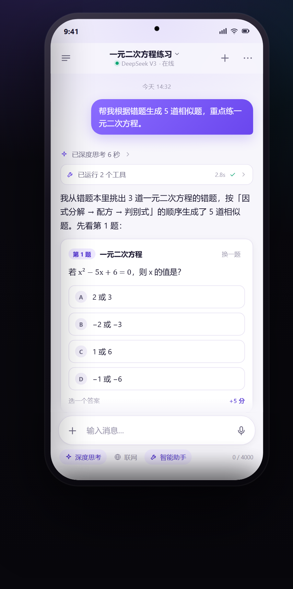
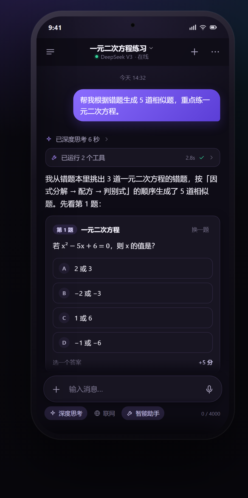
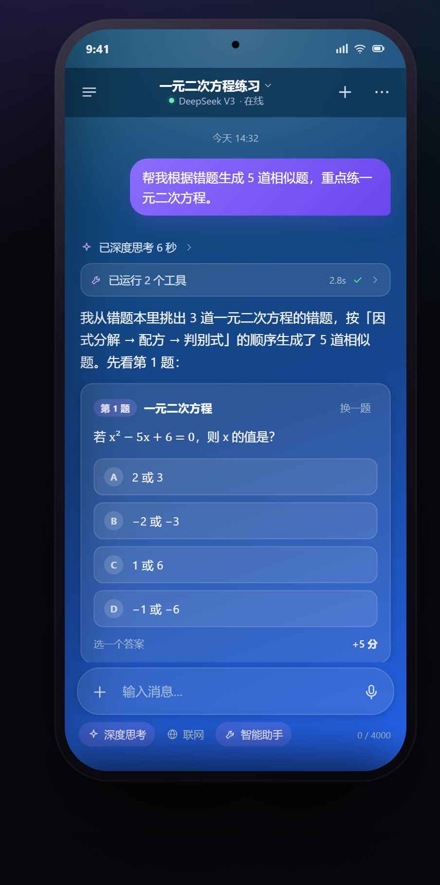
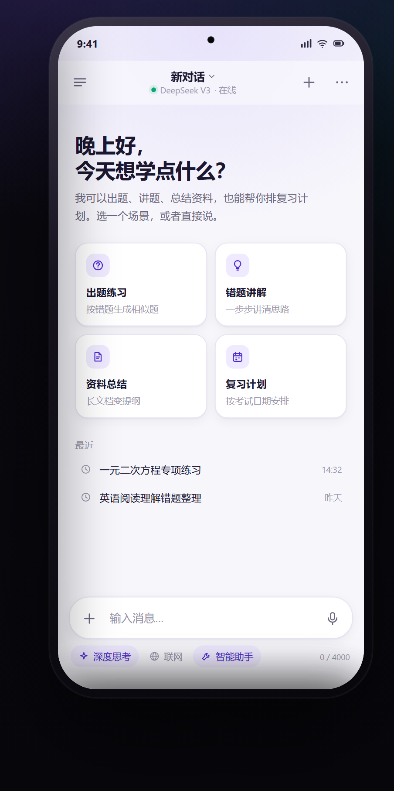
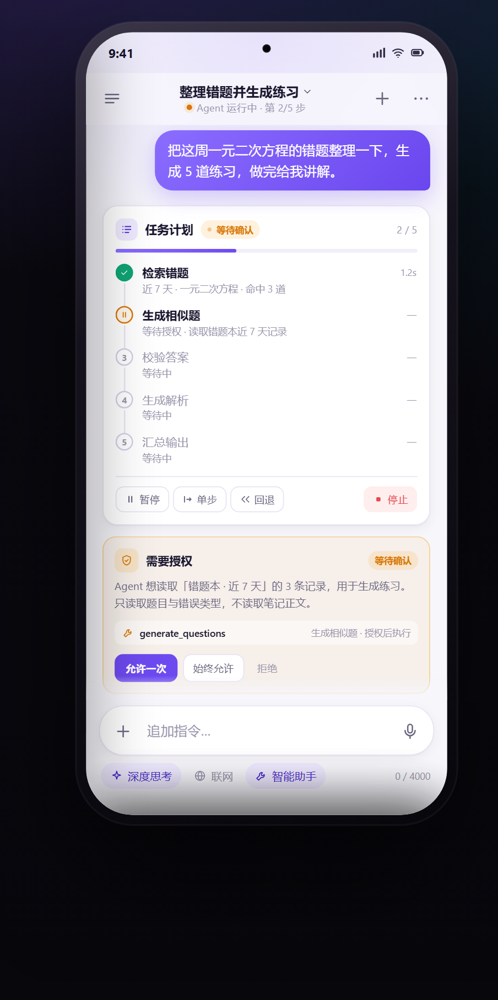
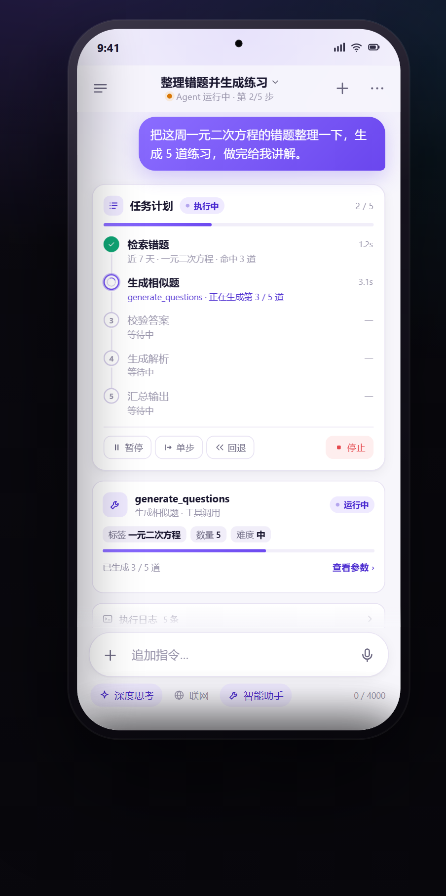
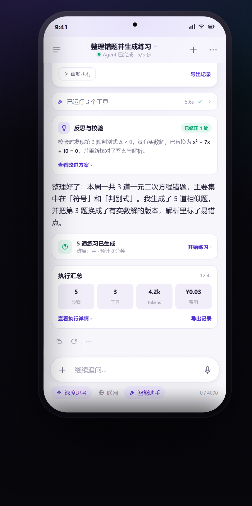
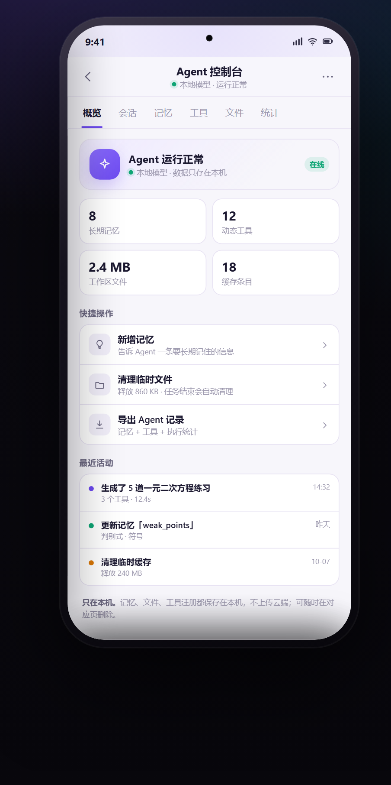
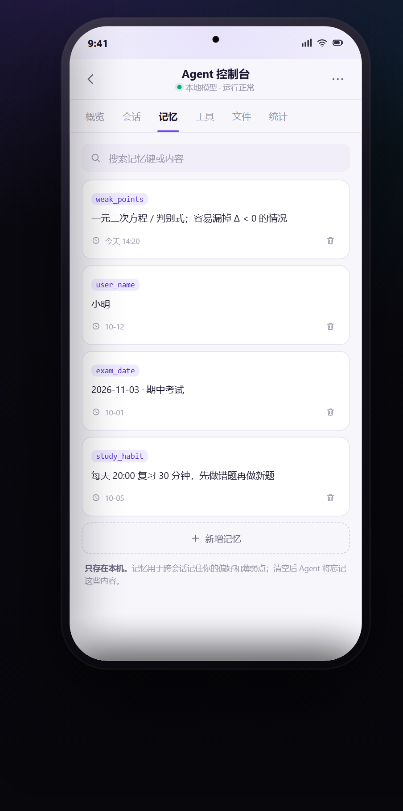
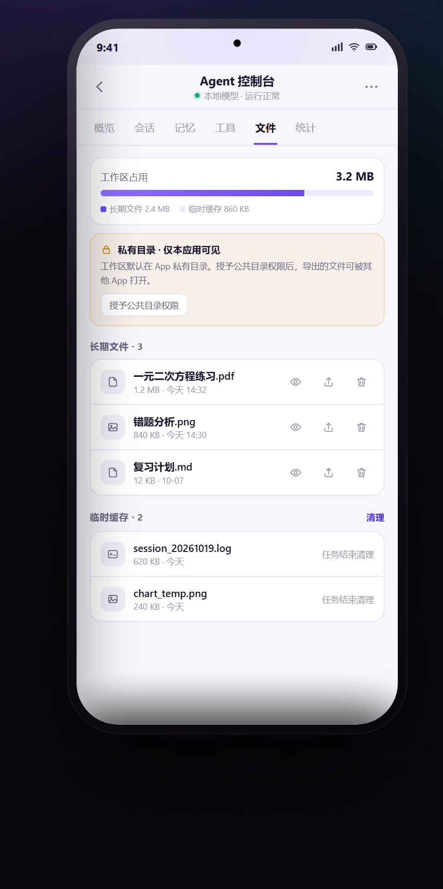

# 答题宝 · AI 对话界面改版方案

> v1 提案 · 2026-10-19
> 范围：`AIChatActivity`、`ChatAdapter` 及全部子 UI（消息、卡片、Agent 执行、Agent 控制台、输入区、抽屉/面板）
> 配套可交互 Demo：`demo/ai-chat-redesign.html`（浏览器直接打开）

---

## 0. 一页结论

现在的对话页不是"做得少"，而是"东西太多、层级太浅"：一屏有 5 条横向功能带、AI 消息内部十余个同级区块、单条消息最多 7 个操作按钮，技术指标（KV、phase、tokens、费用）常驻在视觉黄金区。

改版只做三件事：

1. **收**：一屏只保留 3 层——顶栏 / 对话流 / 输入胶囊。模型、参数、统计、日志全部下沉到面板。
2. **分**：每条 AI 回复固定为 `思考（一行折叠）→ 工具（一组折叠）→ 正文（唯一主角）→ 操作（按需出现）`。
3. **统**：一套颜色、字号、圆角、图标语言；去掉 emoji 图标与硬编码白色，浅色/深色共用语义 token。

不改消息数据模型、不改推理链路，纯 UI/交互层重构，可分三期落地（P0 约 1–2 天，P1 约 3–6 天，P2 约 3–4 天）。

**一图看懂改什么**

| 现在 | 改成 |
|------|------|
| 顶部 3 行状态胶囊 + 常驻连接条 | 1 行模型副标题；连接异常才出横幅 |
| 7 个统计胶囊常驻输入框上方 | 收进「会话信息」面板 |
| 右侧 300dp 工具抽屉 | 输入框 `＋` → Bottom Sheet |
| AI 气泡内十余个同级区块 | 思考 / 工具 / 正文 / 操作，固定四段 |
| Agent 执行 = 日志面板 + 4 种卡片 | 计划 / 授权 / 工具 / 日志 / 反思 / 汇总，6 块 |
| Agent 管理 = 4 Tab（记忆/工具/工作区/统计） | Agent 控制台 6 Tab（概览/会话/记忆/工具/文件/统计） |
| 7 个 11sp 文字操作按钮 | 3 个图标 + 「更多」面板 |
| 停止生成藏在气泡里 | 停止固定在输入框 |
| 空状态 🤖 + 3 个示例 chip | 问候 + 4 张学习场景卡 |

---

## 1. 现状调查

### 1.1 一屏到底叠了多少层

按 `src/main/res/layout/activity_ai_chat.xml` 从上到下：

| # | 层 | 内容 | 位置 |
|---|----|------|------|
| 0 | 背景 | 深蓝渐变 `bg_home_full`（#0C4A6E → #1E40AF → #2563EB） | L8 |
| 1 | 顶部状态胶囊 | 3 行：服务状态+余额 / 进度+耗时+tokens / 生成阶段+KV 缓存 | L19–176 |
| 2 | 电脑连接条 | 常驻 `remote_dsh_bar`：未配对 / 去配对 / 关闭 | L180–234 |
| 3 | 消息列表 | RecyclerView，16dp padding；另有悬浮历史球、回到底部、加载更早 | L247–301 |
| 4 | 生成指示 + 日志 | 3dp 渐变线；可折叠"处理日志"面板 | L384–448 |
| 5 | 会话统计条 | `ChatStatsBar`：上下文、耗时、轮次、工具、任务、tokens、费用 7 个胶囊 | L468 |
| 6 | 模式开关行 | 智能助手 / 深度思考 / 联网搜索 3 个 chip | L488–540 |
| 7 | 排队条 | 忙时排队提示 + 取消 | L543–572 |
| 8 | 输入条 | 附件 + 输入框 + 语音 + 绿色发送按钮 | `view_chat_input_bar.xml` |

即使一条消息都没有，首屏也已经摆了 **5 条横向 chrome**（状态胶囊、连接条、统计条、模式行、输入条），外加两个悬浮球。

### 1.2 消息类型与视图

`ChatAdapter.java`（5,302 行）定义了 11 种消息类型：

| 类型 | 视图 | 现状 |
|------|------|------|
| USER | `item_user_message.xml` | 紫色 16dp 气泡、每条约 12sp 时间戳、状态图标 |
| AI | 代码动态构建（`createAiMessageItem`） | 一个气泡内塞入十余个槽位（见下） |
| SYSTEM / CONTEXT_INJECTION / SYSTEM_PROMPT | `item_system_message.xml` | 灰底系统条 |
| THINKING | `item_thinking_message.xml` | 与 AI 内嵌思考区重复的第二套实现 |
| TOOL_CALL | `item_tool_call_message.xml` | 头部 + 参数 + 结果，全部等宽 12sp |
| AGENT_STEP | `item_agent_step_message.xml` | emoji 图标 + 步骤描述 + 细进度条 |
| AGENT_SUMMARY | `item_agent_summary_message.xml` | 工具数/轮次/耗时汇总 |
| AGENT_REFLECTION | `item_agent_reflection_message.xml` | 反思卡片 |
| ERROR | `item_error_message.xml` | 错误条 |

AI 气泡的构造顺序（同一层级并列）：

```
agentStatus（状态行）
agentProgressSlot（进度环）
agentTimelineSlot（步骤时间线）
btnStop（停止生成）
agentControlBar（暂停 / 单步 / 回退）
thinkingLabel + thinkingContent + divider（思考）
InferenceProgressView（推理进度）
AgentExecutionView（执行面板：日志/参数/结果）
componentContainer（工具卡片）
attachmentsRecycler
contentHost + messageText（正文）
agentSummary（汇总）
────────────────────────────
气泡外：7 个操作按钮 + 状态行 + 模型信息行 + 时间戳
```

### 1.3 子 UI（卡片）清单

`ai/chat/component/` 下有 **30 个 \*CardView**：图表、文件、文件列表、图片网格、HTML、表格、代码、链接、列表、待办、步骤、测验、天气、音视频、联系人、进度、指标、笔记、警告、动态卡片、JSON、Mermaid/Markdown……

能力很全，但每个卡片各自定义圆角、内边距、标题层级和按钮样式，放在同一条消息流里像"不同 App 的截图拼在一起"。

### 1.4 交互清单（现有）

- 生成中：气泡内可暂停 / 单步 / 回退 / 停止
- 最后一条 AI 消息显示 7 个文字操作：复制、朗读、分享、重新生成、👍、👎、新对话（11sp）
- 左侧历史抽屉 + 可拖拽悬浮球（🕘）；右侧 300dp 工具抽屉（模型/模式/管理/其他）
  ——2026-10-20：抽屉里的「快捷工具」段连同引导式工具调用整体删除，清空对话入口移到"其他"行
- 点击顶部状态胶囊、统计条 → 弹明细对话框
- 点击时间戳 → 消息详情
- 附件、语音、排队、加载更早、回到底部

### 1.5 视觉 token 现状

- 主色紫 `#8B5CF6`，强调青 `#06B6D4`，成功绿 `#10B981`；但整页背景是**蓝色**渐变（取自天气页 `future_bg_*`）
- 发送按钮绿色、用户气泡紫色、AI 气泡灰色、状态条白/灰渐变——四种材质同屏
- 大量硬编码半透明白：`#E8FFFFFF`、`#B3FFFFFF`、`#66FFFFFF`，假定背景永远是深蓝
- 圆角混用 12/16/18/22/24/26dp；图标以 emoji 为主（🤖 🔧 💭 📊 💰 🕘 ⏳）

---

## 2. 问题诊断

### P0（直接影响可用性）

**① 技术状态占据第一视觉落点。**
三行状态胶囊 + 7 个统计胶囊 + KV 缓存/生成阶段，对普通用户是噪音；对开发者也只是偶尔要看。新用户打开后不知道"该看哪里、该点哪里"。

**② 答案被过程淹没。**
思考、工具、进度、执行日志、正文全部同级堆叠，正文 14sp 埋在中间；一条回复可能要滑三屏才看到结论。

**③ 操作按钮又小又吵。**
7 个 11sp 文字按钮横排在深色背景上，触控高度不足 48dp，且大部分操作（朗读/分享/赞/踩）低频，却和"重新生成"同等权重。

**④ 视觉语言不统一。**
蓝底 + 紫主色 + 青强调 + 绿按钮 + emoji 图标 + 混用圆角，整体像多个模块拼装，缺少"一个产品"的质感。

### P1（影响效率与完成度）

**⑤ 入口分散。**
历史在左抽屉 + 悬浮球，工具在右抽屉，模型/模式在右抽屉又在输入区，新建对话没有显眼入口；两条抽屉都靠边缘手势，发现性差。

**⑥ 空状态太弱。**
只有 🤖 + 一句话 + 3 个示例 chip + "清空"，没有承接"学习工具"的场景（出题、讲题、总结、计划）。

**⑦ 停止生成不可达。**
停止按钮在 AI 气泡内部，长文生成后已滚出屏幕；竞品普遍把发送/停止放在输入框同一位置。

**⑧ 深色/浅色是"假适配"。**
颜色硬编码在代码里（`#E8FFFFFF`），一旦换背景或改主题就不可读；`values-night` 覆盖不完整。

**⑨ 可读性。**
正文 14sp/1.3 行高偏紧；AI 气泡通栏但内部 12dp 内边距，长段落行长过宽；用户/AI 都带头像、名字、时间戳，信息密度低。

**⑩ 状态反馈不成体系。**
排队、失败、重试、停止、完成各自为政；没有骨架屏、没有完成收尾、没有"已停止 · 继续生成"。

---

## 3. 别人怎么做（竞品参考）

参考 2024 年一份覆盖讯飞星火、文心一言、通义千问、Kimi、豆包的横向分析（[网易转载](https://www.163.com/dy/article/JICVFI8A051181GK.html)、[CSDN](https://blog.csdn.net/xx_nm98/article/details/144111281)），以及 Microsoft 365 Copilot 移动端改版（[Microsoft Design](https://microsoft.design/articles/the-new-microsoft-365-copilot-mobile-experience/)）：

| 模式 | 谁在用 | 说明 |
|------|--------|------|
| AI 回复不加气泡/底色 | 豆包、讯飞星火 | 用户有底色、AI 用页面底色，视线自然落在文字上 |
| 操作按钮在内容下方、弱化 | 豆包、星火、通义 | 复制/重新生成等小图标或低对比文字，不抢正文 |
| 发送/停止同位切换 | 豆包、通义 | 停止固定在输入框，长文滚动也不丢 |
| 思考折叠成一行 | ChatGPT、Claude、Kimi | "已思考 N 秒"，点开才看推理 |
| 模型选择即标题 | ChatGPT | 顶部中间点开切模型，不额外占一行 |
| 输入框"框内 + 框外" | 星火、通义、豆包 | 与输入强相关的放框内，推荐/场景放框外 |
| 空状态建议卡 | 豆包、文心、Gemini | 2×2 场景卡替代示例 chip |
| 重新生成分页对比 | 文心一言、豆包 | 上一版可回看，避免"覆盖式"丢失 |

**值得借鉴**：无气泡 AI、停止进输入框、思考折叠、建议卡、面板化设置、重新生成可回看。

**不照搬**：智能体广场/角色市场（本产品是学习工具，不是 Agent 商店）；全屏高饱和渐变皮肤（长时间阅读疲劳）；把设置塞进输入框（通义/文心的深层菜单反而增加理解成本）。

---

## 4. 设计目标与原则

**目标**：打开即读、读完即走；需要的东西一触即达，不需要的东西一眼不见。

1. **内容优先**：正文是唯一主角，过程信息默认折叠。
2. **一条主线**：每条回复的阅读顺序固定为 思考 → 工具 → 正文 → 操作。
3. **渐进披露**：模型、参数、统计、日志进面板，不占常驻空间。
4. **拇指可达**：发送、停止、附件、语音集中在输入区。
5. **一套语言**：中性画布 + 品牌紫作为唯一强调色，语义色只表达状态。
6. **可读性优先**：正文 15–15.5sp / 1.65，行长 ≤ 34 汉字，正文对比度 ≥ 4.5:1（次要标注 ≥ 3:1）。

---

## 5. 新方案

### 5.1 总览

```
┌────────────────────────────────────┐
│ ☰   一元二次方程练习 ⌄    ＋   ⋯   │  56dp 顶栏（标题 + 模型副标题）
│          ● DeepSeek V3 · 在线      │
├────────────────────────────────────┤
│                                    │
│                    ┌─────────────┐ │
│                    │ 用户消息     │ │  右对齐，紫渐变，无头像
│                    └─────────────┘ │
│                                    │
│  ✦ 已深度思考 6 秒            ›    │  折叠一行
│  ⚙ 已运行 2 个工具 · 2.8s     ›    │  折叠一组
│                                    │
│  好的，我从错题本里挑出了 3 道…      │  正文：无气泡，15.5sp
│  ┌──────────────────────────────┐  │
│  │ 第 1 题 · 一元二次方程        │  │  统一卡片
│  │ A  2 或 3      B  -2 或 -3    │  │
│  └──────────────────────────────┘  │
│  ⧉  ↻  ⋯                          │  按需操作（末条/长按）
│                                    │
├────────────────────────────────────┤
│  ┌──────────────────────────────┐  │
│  │ ＋   输入消息…        🎤   ↑  │  │  52dp 胶囊
│  └──────────────────────────────┘  │
│  🧠 深度思考   🌐 联网   🤖 智能助手 │  28dp 弱化 chip
└────────────────────────────────────┘
```

对比现在：**少了 5 条常驻横条，多了 1 个可点开的模型入口**；首屏留给对话本身。

**效果预览**（`demo/ai-chat-redesign.html` 截图：浅色 / 深色 / 沉浸蓝 / 空状态）

<p>
  
  
  
  
</p>

第三张是**保留现有深蓝品牌色**的方案：结构与浅色完全一致，只把底色换成 `#0C4A6E → #2563EB` 渐变、卡片改 10% 白 + 背景模糊。也就是说，这次改版不强迫你放弃现在的蓝色皮肤。


### 5.2 顶栏

- 56dp，左：历史（抽屉）；中：会话标题 + 模型副标题；右：新建 `＋`、更多 `⋯`。
- 副标题即模型状态：`● DeepSeek V3 · 在线` / `● 本地模型 · 加载 34%` / `● 未连接`（琥珀/红点）。点击整块打开「模型与参数」面板。
- 连接异常才出现横幅（`电脑未配对，去配对 ›`），正常时只留一个点。删掉常驻 `remote_dsh_bar`。
- 滚动时加 1px 分隔 + 背景模糊；回到顶部恢复透明。

### 5.3 消息流

- 日期分隔（"今天 14:32"）替代每条消息时间戳；单条时间进"消息详情"（长按）。
- 用户：右对齐，最大宽 82%，紫渐变气泡，圆角 20/20/6/20，15sp，无头像。
- AI：左对齐，**无头像、无气泡**，15.5sp / 1.65，左右 20dp；正文直接落在画布上。
- 间距：消息组间 20dp，组内 8dp；AI 回复与下一条用户消息之间 24dp。

### 5.4 AI 消息解剖

固定四层，顺序不随状态变化：

1. **思考行**（32dp）：`✦ 已深度思考 6 秒 ›`。生成中显示 `思考中…` + 三点动画；展开后 13sp 次级文字，左侧 2px 引导线。
2. **工具组**（一行）：`⚙ 已运行 2 个工具 · 2.8 秒 ✓ ›`。展开为时间线：工具图标 / 名称 / 参数摘要 / 耗时 / 状态点；点单项看详情。
3. **正文**：Markdown、代码块、卡片；流式时行尾光标。
4. **操作**：仅末条常驻 3 个图标（复制 / 重新生成 / 更多，32dp）；更多里放朗读、分享、赞、踩、新对话。其余消息 hover / 长按出现。

**停止/继续**：停止固定在输入框；停止后正文末尾显示 `已停止 · 继续生成`，不丢已生成内容。

### 5.4.1 Agent 执行子 UI

现有实现是"一个日志面板 + 四种消息卡片"：`AgentExecutionView`（316 行：标题、步骤数、日志、当前步骤、工具参数/结果、tokens）负责执行中，`AGENT_STEP` / `TOOL_CALL` / `AGENT_SUMMARY` / `AGENT_REFLECTION` 又各自是独立消息。用户看到的是多张卡片并列，缺少"计划 → 授权 → 执行 → 校验 → 汇总"的主线；步骤只显示"步骤 1/?"，不知道总共几步、下一步做什么。

新版拆成 6 个固定区块，按时间顺序出现：

| 区块 | 何时出现 | 内容 | 旧实现 |
|------|----------|------|--------|
| 计划卡 Plan | 任务开始 | 目标、进度、步骤时间线（✓ / ● / ○ / !）、暂停 / 单步 / 回退 / 停止 | `AgentExecutionView` 标题 + 步骤数、暂停/单步/回退 |
| 授权卡 Permission | 工具需要敏感权限 | 工具名、读取范围、原因、允许一次 / 始终允许 / 拒绝 | 无（散落在文字回复或系统弹窗） |
| 工具卡 Tool | 授权后 | 工具名、状态、参数 chips、进度、查看参数/结果 | `TOOL_CALL` + `ToolCallCardView` |
| 日志卡 Log | 随时 | 默认折叠，等宽 10.5sp，PLAN / TOOL / OK / WAIT 着色 | `AgentExecutionView` 日志列表 |
| 反思卡 Reflection | 校验后 | 发现了什么、改了什么、查看改进方案 | `AGENT_REFLECTION` |
| 汇总卡 Summary | 完成后 | 步骤 / 工具 / tokens / 费用 + 导出 | `AGENT_SUMMARY` |

状态语义统一走 token：

- 任务：`PENDING` / `RUNNING` / `WAITING_PERMISSION` / `COMPLETED` / `FAILED` / `CANCELLED`
- 步骤：等待（灰）/ 运行（紫 + 脉冲）/ 待授权（琥珀）/ 完成（绿）/ 失败（红）
- 当前步骤只展开一个详情；历史步骤收成一行；日志默认折叠；授权前不渲染工具卡（渐进披露）。

三条硬规则：

1. **计划先行**：任务开始就渲染完整计划，而不是"步骤 1/?"。
2. **授权内联**：权限确认出现在消息流里，写清"读什么、为什么、用多久"；只有系统级权限才跳系统弹窗。
3. **结果可追溯**：完成态保留计划、工具、反思、汇总，可导出执行记录。

效果（运行中等待授权 → 授权后执行 → 完成校验）：

<p>
  
  
  
</p>

> 范围说明：这里只改**聊天流内**的 Agent 执行子 UI。`ai/agent/ui/` 下的管理视图（记忆 / 工具 / 工作区 / 统计）和运行时会话视图 `AgentSessionView`，已合并为下一节的「Agent 控制台」，不再往消息流里塞入口。

### 5.4.2 Agent 控制台（管理页）

现状：`AgentManagerActivity` 是 4 个 Tab（记忆 / 工具 / 工作区 / 统计）的 ViewPager2，每个 Tab 由 `AgentMemoryView` / `AgentToolView` / `AgentWorkspaceView` / `AgentStatsView` 现场 build 一个 LinearLayout。问题很具体：

- 没有「概览」，进来先落到某个具体 Tab，不知道 Agent 整体状态（记得多少、有多少工具、占多少空间）。
- 标题和 Tab 都带 emoji（🧠 记忆 / 🔧 工具 / 📁 工作区 / 📊 统计），与聊天页统一后的图标语言不一致。
- 4 个页面各写各的卡片、输入框、按钮：边框 2dp、圆角 14dp 与聊天页 1dp / 12–14dp 不统一。
- 记忆没有搜索；工具和文件的行内操作不统一（有的「打开/删除」，有的「查看/分享/删除」）。
- 删除、清空直接用 Toast 反馈，没有二次确认。
- `AgentSessionView`（运行时会话）不在这个页面里，用户看不到「这次任务执行到哪了」。

新版合并为 **6 个 Tab 的 Agent 控制台**，入口统一放聊天右上 `⋯`：

| Tab | 回答的问题 | 内容 |
|-----|------------|------|
| 概览 | Agent 现在什么状态？ | 运行状态、4 个指标（记忆 / 工具 / 文件 / 缓存）、快捷操作、最近活动、本机隐私说明 |
| 会话 | 这次任务走到哪了？ | 当前会话（步骤 / 耗时 / 工具数）、最近会话、本周任务 / 成功率 / 平均耗时；「查看执行流」跳回聊天 |
| 记忆 | Agent 记得什么？ | 搜索、key/value 卡片、更新时间、删除、新增、本机隐私说明 |
| 工具 | 有哪些工具和组件？ | 动态工具（名称 / 来源 / 启用状态）、组件注册（类型 / 版本）、清除临时注册 |
| 文件 | 占了什么、能不能给别人？ | 存储占比、私有目录 / 公共目录权限、长期文件（查看 / 分享 / 删除）、临时缓存（自动清理） |
| 统计 | Agent 学得怎么样？ | 调用次数 / 缓存命中 / 平均耗时 / 组合数、Top 工具条形图、已学习组合、日志与缓存清理 |

<p>
  
  
  
</p>

六条规则：

1. **概览先行**：进来先回答"Agent 现在怎么样"，再让用户下钻。
2. **一个入口**：只从聊天右上 `⋯` 进；不再从工具抽屉、设置页各放一个。
3. **统一行式列表**：图标 + 主标题 + 副标题 + 右侧 1–2 个动作；危险动作用红色图标，且必须二次确认。
4. **能搜就能删**：记忆、工具、文件都支持搜索/过滤；删除有撤销或确认。
5. **权限说清楚**：私有目录 vs 公共目录用一段话解释，不靠系统弹窗猜。
6. **会话可回溯**：控制台能看到当前/最近会话，并一键跳回执行流。

代码映射：

- `AgentManagerActivity` + `activity_agent_manager.xml`：4 Tab → 6 Tab，新增「概览」「会话」两个 Fragment。
- `AgentMemoryView`：保留 key/value 模型，加搜索、统一卡片、删除确认。
- `AgentToolView`：动态工具 / 组件注册两段，行内动作统一为「更多」菜单。
- `AgentWorkspaceView`：改名为「文件」，存储占比 + 权限说明 + 长期/临时两段。
- `AgentStatsView`：拆成指标卡 + Top 工具条形图 + 组合 chips + 存储清理。
- `AgentSessionView`：继续作为聊天流内的运行时视图；控制台「会话」Tab 只展示会话列表与状态，不重复渲染执行流。

### 5.5 卡片统一规范

所有 30 个卡片收敛到一个 `CardShell`：

- 容器：12–14dp 圆角、1px 边框、`surface` 底、14dp 内边距
- 头部：16dp 图标 + 13sp 半粗标题 + 右侧一个低频动作
- 正文：13–14sp；数据/代码用等宽 12.5sp
- 底部：最多 2 个文字动作（品牌色）+ 状态
- 圆角、间距、标题字号全部走 token，不再各写各的

### 5.6 输入区（Composer）

- 附件区：仅有附件时出现，32dp chip（缩略图/文件名/进度/移除）。
- 主胶囊：52dp 起，26dp 圆角，1px 边框 + 轻阴影。
  - 左 `＋`：拍照 / 相册 / 文件 / 语音 / 工具中心（底部面板）
  - 中：多行输入，最多 5 行
  - 右：无文字时麦克风；有文字时 36dp 品牌紫发送圆钮；生成中变停止方钮
- 模式行：`深度思考` `联网` `智能助手` 三个 28dp chip，低对比，选中才用品牌色；不再占一整行 padding。
- 生成中：胶囊上方一行 `正在生成 · 3s`，停止随时可点。
- 语音：长按麦克风浮出波形层，松手转文字；编辑即停止录音。

### 5.7 空状态

- 问候语按时间变化："晚上好，想学点什么？"
- 一句能力说明："我可以出题、讲题、总结资料，也能帮你排复习计划。"
- 2×2 场景卡：出题练习 / 错题讲解 / 资料总结 / 复习计划（图标 + 标题 + 一行说明），点击填入输入框。
- 下方"最近对话"两条；没有则显示"从一道错题开始"。
- 去掉 🤖 emoji 与"清空"chip（清空移到历史抽屉）。

### 5.8 抽屉与面板

| 入口 | 形式 | 内容 |
|------|------|------|
| 左上 ☰ | 左抽屉 86% | 搜索、按日期分组、置顶、左滑删除、新建 |
| 标题/模型 | Bottom Sheet | 本地/在线分段、模型列表、上下文占用、温度、推理开关 |
| 右上 ⋯ | Bottom Sheet | 会话信息（轮次/工具/耗时/tokens/费用/上下文）、导出、清空 |
| 输入 `＋` | Bottom Sheet | 拍照、相册、文件、语音、工具中心 |
| 工具中心 | Bottom Sheet 网格 | 出题、总结、翻译、OCR、文件、更多 |
| 处理日志 | 开发者入口 | 长按版本号打开，不再常驻 |

### 5.9 状态与反馈

- 连接：正常只有绿点；异常才横幅 + 一键去配对。
- 队列：输入框上方单行胶囊 `排队中 2 条 · 取消`。
- 错误：消息级错误卡 + `重试`；不弹全局对话框。
- 生成完成：操作行淡入 + 轻震动；长文提供"回到底部"。
- 空/加载：骨架屏（3 行灰条），不用全屏转圈。

### 5.10 动效与深色

- 时长 120 / 180 / 240ms，缓动 `cubic-bezier(.2,.8,.2,1)`；只做位移/透明度，不做花哨缩放。
- 发送按钮 → 停止按钮形变 180ms；思考/工具展开 200ms 高度动画。
- 深色模式全部走语义 token，禁止硬编码 `#FFFFFF` 透明度；对比度按 WCAG AA 校验。

---

## 6. 设计 Token

### 颜色（浅色 / 深色）

| 语义 | 浅色 | 深色 |
|------|------|------|
| bg | `#F7F6FB` | `#0E0C16` |
| surface | `#FFFFFF` | `#181522` |
| surface-2 | `#F1EEF9` | `#221D31` |
| border | `#E8E3F3` | `#2E2740` |
| text | `#1B1830` | `#F3F1FA` |
| text-2 | `#6B6780` | `#A9A3BE` |
| text-3 | `#9A96AC` | `#7E7893` |
| brand | `#6D4AF0` | `#A78BFA` |
| brand-soft | `#EFEAFF` | `#2A2340` |
| success | `#0FA575` | `#34D399` |
| warning | `#D97706` | `#FBBF24` |
| danger | `#E5484D` | `#F87171` |

> 蓝青（`#06B6D4`）保留为图表/次要强调，不再用于按钮与背景大面积铺色。

> 若保留现有品牌：`bg` 用 `#0C4A6E → #1E40AF → #2563EB` 渐变，`surface` 用 10% 白 + `backdrop-blur`，文字用白色，其余 token 不变（对应 Demo 的「沉浸」主题）。

### 字号

| 用途 | 字号 / 行高 |
|------|-------------|
| 页面标题 | 26 / 1.2 |
| 顶栏标题 | 15 / 1.3 |
| 顶栏副标题 | 11.5 / 1.3 |
| 正文 | 15.5 / 1.65 |
| 用户气泡 | 14.5 / 1.55 |
| 卡片标题 | 13 / 1.4 |
| 辅助文字 | 12.5 / 1.5 |
| 最小标注 | 11 |

### 间距 / 圆角 / 阴影

- 间距：4 / 8 / 12 / 16 / 20 / 24 / 32
- 圆角：8（小控件）/ 12（卡片）/ 16（大卡）/ 20（气泡）/ 26（输入胶囊）
- 阴影：`0 1px 2px rgba(27,24,48,.04), 0 4px 16px rgba(27,24,48,.06)`；浮层 `0 12px 40px rgba(27,24,48,.14)`

---

## 7. 落地计划

### P0 · 视觉收敛（1–2 天）

- [ ] 新增语义色/字号/圆角 token（`colors.xml`、`dimens.xml`、`styles.xml`）
- [ ] 重写 `activity_ai_chat.xml`：删状态胶囊三行、连接条、统计条、日志面板
- [ ] 顶栏改为"标题 + 模型副标题 + 新建 + 更多"
- [ ] 输入区三行 chip 压成一行 28dp
- [ ] 全量替换 emoji 图标为矢量图标（聊天范围）
- [ ] 统计/模型/连接信息迁入面板（先用简单 Dialog，P1 换 BottomSheet）

### P1 · 消息重构（3–6 天）

- [ ] 新建 `item_ai_message_v2.xml`，固定"思考行 / 工具组 / 正文 / 操作"四段
- [ ] `ChatAdapter` 拆分：`UserBinder` / `AiBinder` / `SystemBinder` / `ToolBinder`
- [ ] 思考折叠 + 工具组折叠 + 流式光标
- [ ] 操作行改 3 图标 + 更多面板；末条常驻
- [ ] 停止按钮移到输入框，停止后"继续生成"
- [ ] 空状态场景卡
- [ ] 日期分隔替代逐条时间戳
- [ ] **Agent 执行态拆成 Plan / Permission / Tool / Log / Reflection / Summary 六块**
- [ ] `AgentExecutionView` 拆为 `AgentPlanView` + `AgentLogView`；暂停/单步/回退并入 Plan
- [ ] 授权卡内联，授权前不渲染工具卡

### P2 · 面板与一致性（3–4 天）

- [ ] 历史抽屉重做（搜索/分组/置顶/删除）
- [ ] 模型、会话信息、工具中心 BottomSheet
- [ ] `CardShell` 统一 30 个卡片
- [ ] 深色模式走 token；对比度与字体缩放（1.3×）验收
- [ ] 无障碍：contentDescription、48dp 触控、TalkBack 顺序
- [ ] Agent 控制台：`AgentManagerActivity` 4 → 6 Tab（概览 / 会话 / 记忆 / 工具 / 文件 / 统计），入口统一右上 `⋯`
- [ ] 记忆搜索、工具「更多」菜单、文件权限说明与行内动作；危险操作二次确认
- [ ] 控制台空状态 / 加载态 / 导出

### 涉及文件（预估）

| 文件 | 改动 |
|------|------|
| `res/layout/activity_ai_chat.xml` | 重写，-40% 层级 |
| `res/layout/view_chat_input_bar.xml` | 重写胶囊输入 |
| `res/layout/item_user_message.xml` | 去头像/时间戳 |
| 新增 `item_ai_message_v2.xml` | AI 四段结构 |
| `ChatAdapter.java` | 拆 Binder，AI 构造器重写 |
| `ChatStatsBar.java` | 改为 `SessionInfoSheet` |
| `view_tool_drawer.xml` | 改为 `ToolCenterSheet` |
| `AgentExecutionView.java` | 拆为 `AgentPlanView` + `AgentLogView` |
| `item_agent_step_message.xml` | 合并进 Plan 的步骤行 |
| `item_tool_call_message.xml` / `ToolCallCardView` | 合并为 Tool 卡 |
| `item_agent_summary_message.xml` / `item_agent_reflection_message.xml` | 改为 Summary / Reflection 卡 |
| `AgentManagerActivity.java` / `activity_agent_manager.xml` | 4 → 6 Tab，新增概览 / 会话 |
| `AgentMemoryView.java` / `AgentToolView.java` / `AgentWorkspaceView.java` / `AgentStatsView.java` | 统一列表、卡片、危险操作确认 |
| 新增 `AgentOverviewView` / `AgentSessionListView` | 概览 Tab 与会话 Tab |
| `colors.xml` / `dimens.xml` / `styles.xml` | 新 token |
| `ai/chat/component/*.java` | 逐批接 `CardShell` |

### 风险与对策

- `ChatAdapter` 5,300 行、`AIChatActivity` 10,000+ 行：**不动业务逻辑**，先加 `chat_ui_v2` 开关，新旧并行，灰度高危路径可回退。
- 30 个卡片逐个迁移成本高：先统一外壳（圆角/边框/标题），内部图表不动。
- 流式性能：AI 视图减少嵌套层级本身就是收益；保留 `StreamingUpdateManager`。
- 深色回归：用截图对比 + 对比度脚本卡门禁。

---

## 8. 验收清单

- [ ] 首屏常驻横条 ≤ 1（顶栏）+ 1（输入区），无技术指标
- [ ] 任何一条 AI 回复，正文在 2 屏内可见；过程信息默认折叠
- [ ] 停止生成在输入框内，滚动到任何位置都可点
- [ ] 所有可点元素 ≥ 44×44dp；正文对比度 ≥ 4.5:1
- [ ] 字体缩放 1.3× 不截断、不重叠
- [ ] 深色模式无硬编码白色残留
- [ ] 200 条消息滚动/流式更新不掉帧（Jank < 1%）
- [ ] TalkBack 能按"标题 → 思考 → 工具 → 正文 → 操作"顺序朗读
- [ ] Agent 执行中能看到"第几步 / 共几步 / 下一步是什么"
- [ ] 授权在消息流内完成，说明读取范围；系统权限除外
- [ ] Agent 日志默认折叠，单条可复制；完成态可导出执行记录
- [ ] Agent 控制台首屏能回答"记得什么 / 有什么工具 / 占多少空间"
- [ ] 记忆可搜索，工具/文件可查看删除，危险操作有二次确认
- [ ] 控制台入口唯一（聊天右上 `⋯`），不再散落在工具抽屉/设置页

---

## 9. Demo 说明

`[demo/ai-chat-redesign.html](../../demo/ai-chat-redesign.html)` 是单文件、零依赖的高保真原型，浏览器直接打开：

- 浅色 / 深色 / 沉浸蓝三种主题切换
- 对话 / Agent / 控制台 / 空状态四种界面切换
- Agent 运行中 / 已完成两种状态；点"允许一次"可看授权后的工具执行
- 控制台 6 个 Tab：概览 / 会话 / 记忆 / 工具 / 文件 / 统计；记忆可搜索、删除，文件权限可授权
- 模型面板、会话信息、历史抽屉、附件面板
- 发送消息 → 模拟"思考 → 工具 → 流式正文 → 卡片 → 操作"全过程；可中途停止
- 点击选项可答题；"设计标注"开关显示 5 个关键改动点

Demo 只验证视觉与交互，不含业务逻辑；P1 落地时以 `item_ai_message_v2.xml` + Binder 为实现基线。

---

## 附录：顺手要清理的字符串

- `chat_speak` = `🔊 朗读`、`chat_thinking_process` = `💭 思考过程`、`chat_task_breakdown` = `📋 任务分解` 等把 emoji 写进文案的条目
- `chat_tokens_format` = `⚡ %1$d tokens` 这类面向开发者的展示
- 三套并存的思考视图（`item_thinking_message` + AI 内嵌思考区 + `ThinkingSegmentRoller`）合并为一套
